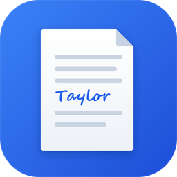

  

<h1 align="center">Local Word</h1>

  <b>Writing and document design; an open-source, modern word processor, built in pure Rust.</b>

  A fast, open-source word processor with a familiar workflow: the ribbon, styles,
  tables, track changes, references and mail merge. It reads and writes .docx, runs natively on
  macOS, Windows, Linux and BSD, and in the browser via WebAssembly. 

  <a href="https://github.com/Anon5T4R/local-office"><b>Local Word on GitHub</b></a>

 

## Why Local Word

- **Familiar.** Ribbon tabs, groups, shortcuts and behaviour: Enter continues a list,
  Tab demotes it, Ctrl/⌘+B bolds the word under the caret, the Styles gallery previews styles live,
  F4 repeats, F7 checks spelling, F8 extends the selection.
- **Your files.** Opens and saves .docx (OOXML), and also .odt, .rtf, .html, .md, .tex (LaTeX), .txt; opens legacy 97-2003 .doc; exports PDF
  with real, selectable text, links and bookmarks.
- **Fast.** Paragraph layout is cached, so typing in a 188-page document re-lays it out in about
  1.4 ms; pages render on demand.
- **Everywhere.** One Rust codebase for macOS, Windows, Linux, BSD and the web. No Electron, no
  Tauri: native [egui](https://github.com/emilk/egui) on the GPU.
- **Built for agents.** Every action is a command with an id. The same 422 commands drive the
  ribbon, keyboard shortcuts, the command search, a command-line tool, a JSON control channel and
  an MCP server.
- **Private.** Spelling, grammar and everything else work offline.
- **Open.** MIT OR Apache-2.0. Clean-room: built from public specifications and observation, with
  every asset original or openly licensed.

## License and credits

Local Word is dual-licensed under [MIT](LICENSE-MIT) or [Apache-2.0](LICENSE-APACHE), at your option.
Copyright (c) 2026 ArtCraft Team and the Local Word contributors. Required notices are in [NOTICE](NOTICE).

Bundled fonts, icons, images and other assets keep their own open licenses; each one is listed
with its author, source and license in [ATTRIBUTION.md](ATTRIBUTION.md).

The English spelling dictionary and hyphenation come from Grady Ward's public-domain Moby
Hyphenator II word list. Polish spelling reads the Hunspell `pl_PL` dictionary installed on the system (not bundled), as
do Russian, Portuguese, Czech, Italian, Croatian and Turkish spelling (how to install them:
[docs/spelling-dictionaries.md](docs/spelling-dictionaries.md)), and
Polish hyphenation the TeX patterns by Hanna Kołodziejska, Bogusław Jackowski and Marek Ryćko (MIT
option). The sample documents and templates are original text written for Local Word.

Local Word is an independent fork of WordCraft, maintained by Anon5T4R in the Local suite.
"WordCraft" and "ArtCraft" are names of the upstream project and its team; this repository uses
only the Local Word name.

  Suíte Local — apps locais, sem conta, sem telemetria.

