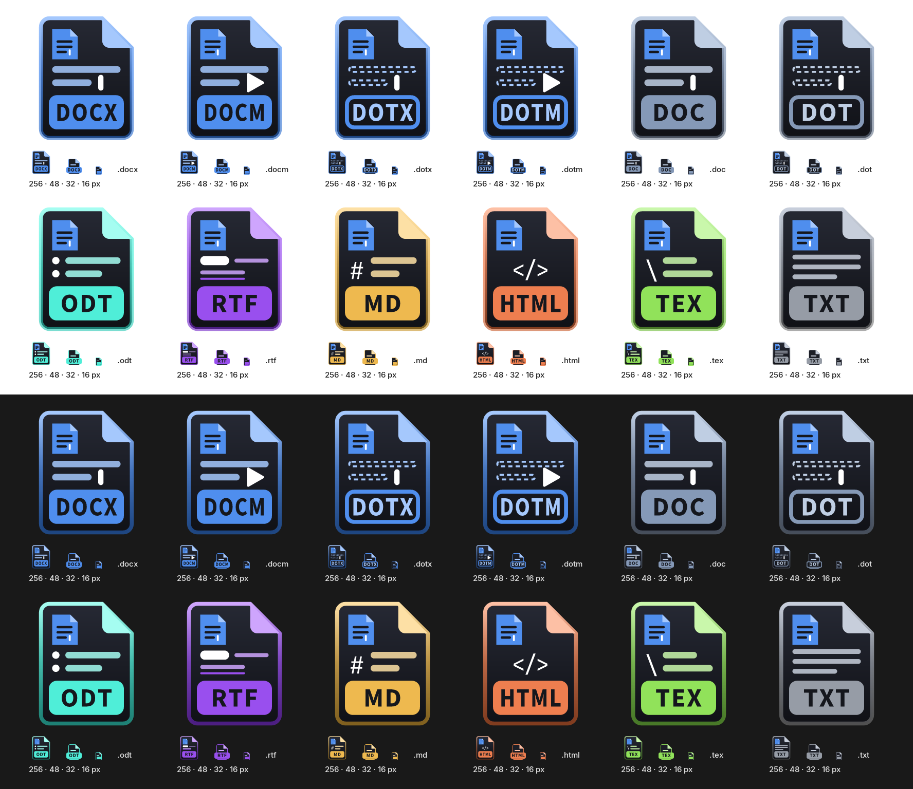

# Local Writer file-type icons

The icons Windows (and later Linux) shows for the documents Local Writer opens: one per ProgId in
`packaging/windows/localwriter.wxs`. This is the artwork only. Nothing registers these icons yet;
the ProgIds still point at the app icon.

## The family

Every icon is the suite's night tile turned into a sheet of paper: the dark gradient body
(`#262934` → `#101116`), a 3-unit ring in the format's hue that fades towards the bottom, a folded
corner in the light tone of that hue, and flat shapes with round ends. On the sheet, top to bottom:

1. **The Local Writer mark**, small, top left: the blue page of `assets/app-icon/localwriter.svg`,
   always in the app's own blue, whatever the format.
2. **The body**: text lines in the light tone of the hue, with the one white accent that tells the
   format apart (the night icons have a single white element each).
3. **The label**: the extension in capitals, dark on a block of the format's hue.

Four rules cover every format:

| Rule | Meaning |
|---|---|
| Hue | The format family. Word formats share the app's blue. |
| Outlined label, dashed lines | A template: an empty frame to fill in. |
| Washed-out hue | A legacy binary format. |
| White accent | What is particular to the format (table below). |

| File | Format | Hue | White accent |
|---|---|---|---|
| `docx` | Word document | blue, `hsl(216 82% 62%)` | the Writer caret |
| `docm` | Word macro-enabled document | blue | a "run" triangle |
| `dotx` | Word template | blue, outlined | the caret |
| `dotm` | Word macro-enabled template | blue, outlined | the triangle |
| `doc` | Legacy Word document | washed-out blue, `hsl(216 26% 62%)` | the caret |
| `dot` | Legacy Word template | washed-out blue, outlined | the caret |
| `odt` | OpenDocument Text | teal, `hsl(172 82% 62%)` | list bullets |
| `rtf` | Rich Text document | violet, `hsl(268 82% 62%)` | a bold run, beside a regular and an underlined one |
| `md` | Markdown document (`.md`, `.markdown`) | amber, `hsl(40 82% 62%)` | `#` |
| `html` | Web page (`.html`, `.htm`) | orange, `hsl(18 82% 62%)` | `</>` |
| `tex` | LaTeX document (`.tex`, `.ltx`, `.latex`) | green, `hsl(96 70% 62%)` | `\` |
| `txt` | Plain text document | neutral grey, `hsl(220 8% 62%)` | none: three even lines |

None of this borrows from another vendor's document icons: no letter badge, no overlapping panels,
no logo of a format's owner. The shapes are plain geometry written for this repository.

## Sizes

Each format has three drawings, because a 100-unit design does not survive 16 pixels:

| File | Used for | What it keeps |
|---|---|---|
| `<ext>.svg` | 48 px and up | everything |
| `<ext>-32.svg` | 32 and 40 px | sheet, fold, one line, and the label grown past the sheet so it stays readable |
| `<ext>-16.svg` | 16, 20 and 24 px | sheet, fold, one line and a block of the hue (outlined for templates); no letters |

The two small ones are drawn on their pixel grid (`viewBox` 32 and 16), with flat fills instead of
gradients. At 16 px the format reads by colour alone, so the four Word-blue icons differ only in
filled against outlined.

## Regenerate

`python packaging/file-icons.py` rewrites every SVG and `preview.png`. All the geometry, hues and
rules above live in that script; edit it, not the SVGs. It needs Python with fontTools and Pillow,
and `resvg` on PATH for the proof sheet.

## Provenance

Original work, drawn for this repository; `MIT OR Apache-2.0`, like the code. The letters and the
`#`, `</>` and `\` marks are glyph outlines of Source Sans 3 Bold and JetBrains Mono Regular
(`assets/fonts`, OFL-1.1), stored as paths so the SVGs carry no `<text>` and render the same
everywhere.
